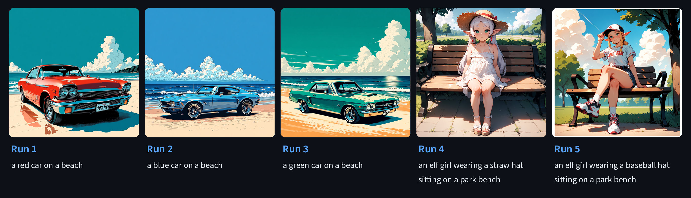
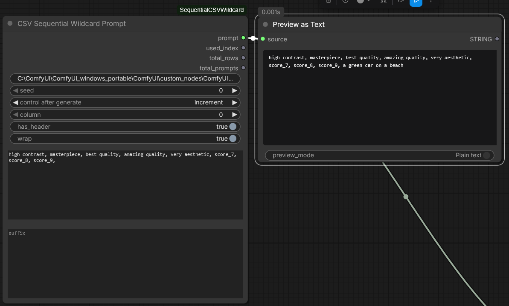

# ComfyUI Sequential CSV Wildcard

A ComfyUI custom node that loads prompts from a CSV file and walks through every `{option1|option2}` wildcard combination in order — row by row, not at random.



The grid above is a batch of 5 runs against [`examples/example.csv`](examples/example.csv), with the seed starting at 0 and **control after generate** set to increment.

## How it works

The example CSV has a header row and two data rows:

```csv
prompt
a {red|blue|green} car on a beach
an elf girl wearing a {straw| baseball} hat sitting on a park bench
```

The first row expands into 3 prompts (red, blue, green). The second expands into 2 (straw hat, baseball hat). That is 5 prompts in total, so `total_rows` is 2 and `total_prompts` is 5.

The seed walks through every combination of row 1 first, then every combination of row 2. If `wrap` is on, it then loops back to the start.

With seed `0` and increment, those 5 runs expand in this order:

| Run | Seed | Prompt |
| ---: | ---: | --- |
| 1 | 0 | a red car on a beach |
| 2 | 1 | a blue car on a beach |
| 3 | 2 | a green car on a beach |
| 4 | 3 | an elf girl wearing a straw hat sitting on a park bench |
| 5 | 4 | an elf girl wearing a baseball hat sitting on a park bench |

Set Batch count to `total_prompts` (5 in this example) to generate each prompt once.

The example images were generated with this prefix added in front of each expanded prompt (the table and grid captions show the CSV text only):

```text
high contrast, masterpiece, best quality, amazing quality, very aesthetic, score_7, score_8, score_9,
```



The node lives under **prompt/csv** and is named **CSV Sequential Wildcard Prompt**. The screenshot shows the example settings, with the `prompt` output connected to a Preview as Text node so you can read the full expanded prompt for each run (here, the green-car combination).

## Inputs

| Input | Description |
| --- | --- |
| `csv_path` | Full path to your `.csv` file |
| `seed` | Position in the expanded prompt list. Set **control after generate** to **increment** to step through combinations one per queued generation |
| `column` | Which column (0-based) holds the prompt text |
| `has_header` | Skip the first row if it is a header |
| `wrap` | Loop back to the first combination after the last one; if off, a seed past the end raises an error |
| `prefix` / `suffix` | Optional text added before / after the expanded prompt. Nothing extra is inserted between them, so include a trailing space or newline in the prefix if you want a separator |

## Outputs

| Output | Description |
| --- | --- |
| `prompt` | The final prompt string, with wildcards expanded and prefix/suffix applied |
| `used_index` | The position in the expanded list (0-based). With wrap on, this is `seed % total_prompts` |
| `total_rows` | Number of data rows in the CSV (the header is not counted) |
| `total_prompts` | Total number of combinations across all rows. Set Batch count to this value to generate every prompt once |

## Wildcard order

When a row has more than one `{a|b}` group, the first group changes fastest.

For example, `a {red|blue} {car|bike}` expands in this order:

1. `a red car`
2. `a blue car`
3. `a red bike`
4. `a blue bike`

After that, the next CSV row begins.

Spaces around each option are trimmed, so `{straw| baseball}` is treated the same as `{straw|baseball}`.

## Tips

- Run once (or inspect `total_prompts`) and set **Batch count** to that number to get each prompt once.
- Leave `wrap` on to loop the list. Turn it off if you want an error once you pass the last combination.
- Leave `has_header` on when the first row is a column name, like `prompt` in the example file.
- Connect the `prompt` output to a **Preview as Text** node to see exactly which prompt each run produced — handy for checking the order before or while you generate images.
- `csv_path` must be a full path to the file on the machine running ComfyUI.

## Installation

Install through **ComfyUI-Manager** (search for "Sequential CSV Wildcard"), or clone into your custom nodes folder:

```bash
cd ComfyUI/custom_nodes
git clone https://github.com/Rightey/ComfyUI-SequentialCSVWildcard
```

No extra Python dependencies are required. An example CSV is included at `examples/example.csv`.

## License

[GPL-3.0](LICENSE)
